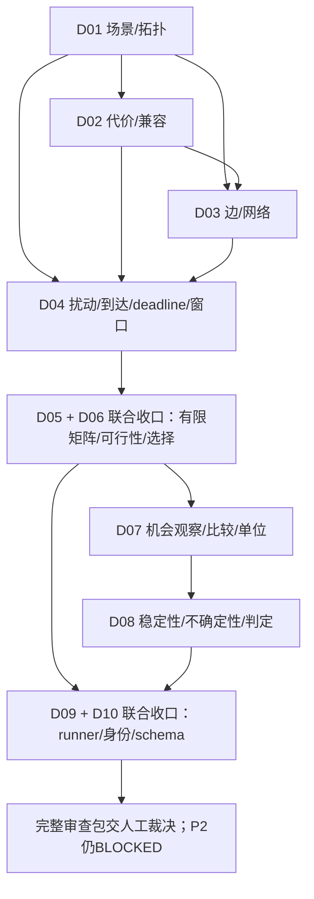

# D01–D10 决策依赖图（审查材料，不是执行计划）

编号沿用原目录。下图是设计收口关系的逻辑分析，不新增研究规则或审批顺序。
“可并行讨论”不等于“可在依赖未定时冻结参数”，更不意味着可运行 P2。

| 决策 | 可立即并行讨论的部分 | 最终定义依赖 | 原因/来源 |
|---|---|---|---|
| D01 | 显式模板与grammar的可审计性、业务角色 | 无其他新决定前置，但必须遵守已有场景/8–16节点约束 | workload_spec.md:3–12；model_spec.md:4–14 |
| D02 | profile或合成来源与参数表示 | D01的角色/节点；实际扰动关系还需D04 | model_spec.md:10–14,54–58；workload_gaps.md:12–14 |
| D03 | 单位/来源/参数表形式 | D01边与D02兼容端点；物理公式已定不重批 | model_spec.md:20–31；workload_gaps.md:15–17 |
| D04 | PRNG/key版本纪律、到达/窗口候选形式 | D01–D03；deadline/可行性与D06需协调 | model_spec.md:4–8,39–58；workload_gaps.md:18–22 |
| D05 | 显式列表或有限轴展开、方法子集选择的理由 | D01–D04具体输入；D06控制与停止规则；若包含机会诊断/计时还需D07/D08/已有timing登记 | calibration_options.md:8–18 |
| D06 | 失败类别、H独占/低竞争的利弊 | D01–D04输入；D05的方法/轴/顺序；最终预算由D05展开重核 | workload_spec.md:14–20；calibration_options.md:14–18 |
| D07 | M1/M2及其混杂/信息边界问题 | D01–D04定义机制和可用输入；D05实际比较方法；D06有效性分类 | mapping_criterion_options.md:7–24 |
| D08 | seed独立单位、不得挪用H/L门槛等已定事实 | D07观察量/分母；D05条件范围；D06缺失/不可行处置 | statistical_protocol.md:3–16,34–47；mapping_criterion_options.md:26–42 |
| D09 | R1/R2、幂等与停止策略、开始/结束记录的审查 | D05可执行计划、D06失败分类、D08判据出口；D10身份/schema需联合收口 | runner_and_schema.md:6–44 |
| D10 | 来源隔离、旧P1不能改标签、S1/S2可行性审查 | D01–D05生成血缘/条件身份；D07–D08诊断/指标引用；D09生命周期 | runner_and_schema.md:46–79；schema草案267–330,570–617 |

D05/D06 有双向协调关系：先讨论轴和控制要求，再一起形成可展开的最终列表/预算，
不能用未批轴和值先做实验来消除分歧。D09/D10 也需共同裁决身份、生命周期和兼容路线。
因此图中将它们合并为联合收口节点，不把互相引用伪装成可线性执行的程序 DAG。

可并行的材料工作包括：D01–D04 的来源/表示审查、D05/D06 的矩阵与处置框架、
D07/D08 的机制/统计解释、D09/D10 的接口与来源兼容审查。最终参数与正式批准必须等待
相应依赖补齐。以上依赖属于 LOGICAL_INFERENCE；没有新增参数、候选、阈值或分区。
